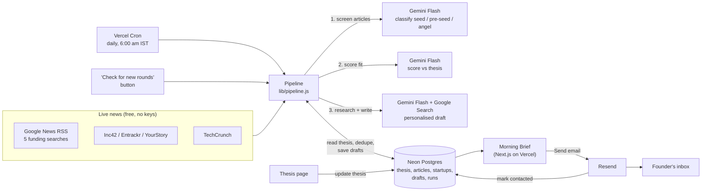

# FreshRaise: Components Map

| Component | Tool | What it does |
|---|---|---|
| News sources | Google News RSS, Inc42, Entrackr, YourStory, TechCrunch | Live funding announcements, no API key |
| Scheduler | Vercel Cron (`vercel.json`) | Runs the pipeline every morning |
| Pipeline | `lib/pipeline.js` | Fetch, filter last 24h, dedupe, score, draft |
| AI | Gemini Flash (`lib/gemini.js`) | Classifies articles, scores fit, researches and writes emails |
| Database | Neon Postgres (`lib/db.js`) | Thesis, seen articles, startups, drafts, run history |
| Duplicate guard | `startups.name_key` UNIQUE + `articles.url` PK | A startup can only ever get one draft |
| Configurable thesis | `thesis` table | Read fresh on every run, so edits apply with no code change |
| Email sending | Resend (`lib/resend.js`) | Sends approved drafts |
| Interface | Next.js App Router | Morning Brief (drafts) and Thesis pages |

## Startup status lifecycle

`new` → scored → `rejected` (hidden from Rohit) **or** `fit` → `drafted` → `sent` / `skipped`
