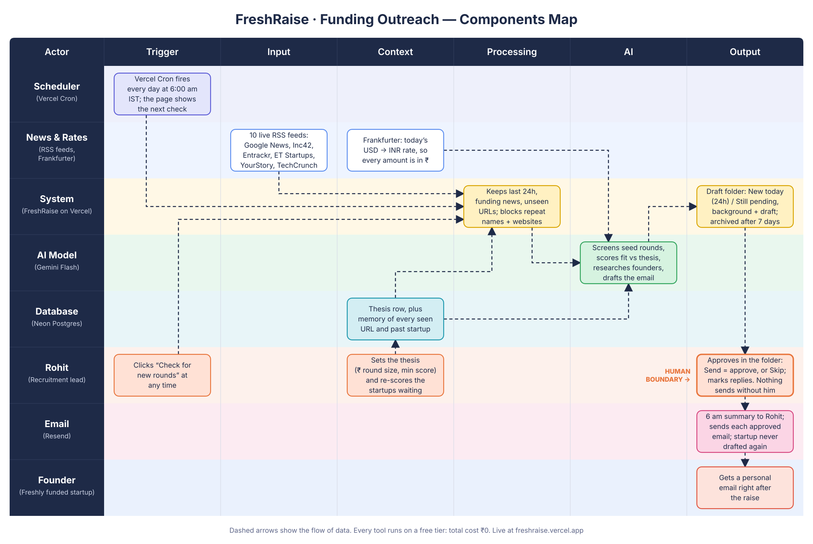

# FreshRaise: Components Map

Every morning, FreshRaise finds Indian and Indian-founded startups that announced a pre-seed, seed or angel round in
the last day, scores each one against the accelerator's thesis, researches the ones that fit, and leaves an outreach
email ready for Rohit to approve. Startups that don't fit are never shown. No startup is ever drafted twice.

**Live:** https://freshraise.vercel.app · **Code:** https://github.com/Rashmi-0704/freshraise



PNG version for slides: [docs/components-map.png](docs/components-map.png)

## Component details

| Step | Component | Tool | What it does | Status |
|---|---|---|---|---|
| Trigger | Daily run | **Vercel Cron** (`vercel.json`, `app/api/cron/route.js`) | Runs the pipeline at 00:30 UTC (6:00 am IST), protected by `CRON_SECRET`; the Morning Brief shows "Next automatic check" | ✅ Registered |
| Trigger (manual) | "Check for new rounds" button | Next.js server action (`app/actions.js`) | Same pipeline, on demand | ✅ Live |
| Input | Live news | 10 free RSS feeds (`lib/feeds.js`): 5 Google News searches, Inc42, Entrackr, ET Startups, YourStory, TechCrunch | Pulls about 190 articles in parallel, no API keys | ✅ All 10 working |
| Processing | Filter | `lib/pipeline.js` | Keeps the last 24 hours, funding-looking titles, no Series B+, never-seen URLs; up to 100 articles | ✅ |
| AI | Screen | **Gemini Flash** (`gemini-3.8-flash`, `lib/gemini.js`) | Picks real pre-seed / seed / angel rounds with an Indian link, in one request | ✅ |
| Dedupe | Never twice | **Neon Postgres** | Startup name key is UNIQUE; a website can only ever have one draft | ✅ Tested (5 of 5 repeats blocked) |
| Context | Thesis | `thesis` table in Neon | Sectors, stages, geography, round size (₹), exclusions, minimum score; read fresh every run | ✅ Tested (65 → 90 changed results, no code edit) |
| AI | Score | **Gemini Flash** | Scores 0-100 with a fixed scale and a one-sentence reason, plus a 0-5 rating for each check (sector, stage, geography, round size) shown as bars. Hidden if below the minimum **or** if any check is 0/5 (a hard fail, e.g. round size out of range) | ✅ Tested (Desible.ai, round size 0/5, hidden at 65) |
| AI | Research + draft | **Gemini Flash + Google Search** | Finds website, company background, founders with roles and backgrounds, then writes a short email | ✅ |
| Context | Rupees | **Frankfurter** (free, no key, ECB rates; `lib/money.js`) | Converts dollar amounts to ₹ crore / lakh at today's rate | ✅ |
| Storage | Everything | **Neon Postgres** (replaces Supabase, approved) | `thesis`, `articles`, `startups`, `drafts`, `runs` tables, created automatically | ✅ |
| Output | Draft folder (Morning Brief) | Next.js 14 on **Vercel** (Singapore region) | Rohit's draft folder, split into **New today** (announced in the last 24 hours) and **Still pending**; each draft shows round, ₹ amount, fit score, a ring counting down the days left, company background, founders and the editable email. Drafts are archived 7 days after the announcement (article publish date) | ✅ |
| Output | Send | **Resend** (`lib/resend.js`) | Sends the approved email; test mode sends to our own inbox | ✅ Test email received |
| Output | Morning email | **Resend** (`lib/digest.js`) | After the 6 am run, emails Rohit the drafts waiting (₹ amount, fit) and a link, or a problem report if the run failed; nothing on a quiet morning | ✅ Test email sent |
| Output | Replies | Morning Brief, "Sent so far" | Rohit marks which founders replied; shows sent → replied (%) | ✅ |
| Context | Re-score | Thesis page button (`rescoreWaiting` in `lib/pipeline.js`) | Scores waiting startups against the current thesis; drafts that no longer fit are hidden, not deleted | ✅ Tested (97 hid 2, back to 65 restored them) |
| Code | Repo | **GitHub** (public) | Push to `main` → Vercel deploys | ✅ |

```
Vercel Cron (6 am IST) ─┐
                        ├─→ 10 RSS feeds → filter → Gemini: screen → Neon: dedupe ─┐
"Check" button ─────────┘                                                          │
                       ┌───────────────────────────────────────────────────────────┘
                       ↓
          Gemini: score vs thesis (Neon) ─┬─ below minimum → hidden, logged as rejected
                                          └─ fit → Gemini + Google Search: research + draft
                                                         ↓
                                Morning Brief (Vercel) + 6 am email → Rohit edits → Resend → founder → Rohit marks reply
```

**Cost:** ₹0. Every tool runs on a free tier with no credit card: Gemini (AI Studio), Neon, Resend, Vercel Hobby,
GitHub, RSS feeds and Frankfurter.

## Why the draft folder is in the app, not in Gmail

The brief asks for drafts "sitting in Rohit's draft folder." FreshRaise's Morning Brief **is** that folder: every
researched email waits there, and **Send is the approval step**, so nothing reaches a founder until Rohit clicks it.
We chose this over writing real Gmail drafts (Gmail API `users.drafts.create`) because:

- **Hard rule 5** says emails are sent with Resend. Gmail drafts would be sent from Gmail instead.
- The Gmail API needs Rohit to sign in with Google and grant mailbox access (OAuth), which adds setup and risk for a
  daily tool.
- The in-app folder can show what a Gmail draft can't: the fit score and reason, company background, founders, the
  time left, and the reply rate.

**Freshness rules** (from the article's publish date, not when we read it): drafts announced in the last 24 hours
sit under **New today**; older ones sit under **Still pending**; after 7 days (`ARCHIVE_AFTER_DAYS`) they're archived,
not deleted, so the startup still counts for "never contact twice". The morning email only goes out when something is
new today.

## The Nine Checks: does this deserve to be built?

### ⚡ Kill switches (any No means: don't build it)

| # | Check | Answer | Evidence |
|---|---|---|---|
| 01 | Problem real? | ✅ Yes | Founders are easiest to reach right after a raise, and Rohit currently finds them by reading the news by hand every morning. Missing the window means another accelerator gets there first. |
| 02 | Workflow repeated? | ✅ Yes | Every single morning, the same steps: read the news, spot seed rounds, check fit, research, write. In testing, one week of news had at least 9 Indian pre-seed / seed rounds. |
| 03 | Input available? | ✅ Yes | 10 free, keyless, live RSS feeds return about 190 articles per run (all 10 tested working). Google Search grounding fills in founders and background. |

### 📊 Sizing (any No means: build something smaller)

| # | Check | Answer | Evidence |
|---|---|---|---|
| 04 | Output valuable? | ✅ Yes | Rohit gets a ready-to-send email plus the company background, the founders' roles and past companies, and a fit score with a reason. He only reviews, edits and clicks Send. |
| 05 | Impact measurable? | ✅ Yes | Every run is logged in the `runs` table (articles read, rounds found, set aside, duplicates, drafted). The `drafts` table records sent vs skipped, and Rohit marks replies on the Morning Brief, which shows **sent → replied (%)**: the real measure of whether the outreach works. |
| 08 | ROI worth it? | ✅ Yes | Running cost is ₹0 (all free tiers). It replaces the daily news reading and the per-startup research. The time saved is an estimate to confirm with Rohit, and it scales with how many rounds are announced. |

### 🚧 Boundary (any No means: put a human exactly here)

| # | Check | Answer | Where the human sits |
|---|---|---|---|
| 06 | Failure risk OK? | ✅ Yes, with a human at Send | The worst case is a wrong or awkward cold email, so **nothing is sent without Rohit clicking Send**. Test mode routes every email to our own inbox. A startup the AI wrongly rejects is only a missed lead, and Rohit can lower `min_fit_score` to see more. |
| 07 | Judgment protected? | ✅ Yes | AI only finds, scores and drafts. **Rohit decides** who fits (he owns the thesis), whether to contact them, and what the email says (he can edit or skip). The AI never sends on its own. |
| 09 | Owner clear? | ✅ Yes | **Rohit** owns the thesis and every send. **The builder (Rashmi)** owns the system: API keys, feeds and the daily cron. If the 6 am run fails, Rohit gets an email saying so, the Morning Brief shows "Last check hit a problem" with the reason, and the `runs` table keeps the history. |

Technical safeguards that keep the daily run reliable (time limits, rate limits, duplicate guards) are listed in the
README under **Reliability safeguards**.

## Hard rules: where they're enforced

| Rule | Where |
|---|---|
| Gemini Flash for every AI task, via Google AI Studio | `lib/gemini.js` is the only AI client; no other AI SDK in `package.json` |
| Live external data | 10 live RSS feeds (`lib/feeds.js`) and the live exchange rate (`lib/money.js`) |
| Deployed on Vercel with a public URL | https://freshraise.vercel.app |
| Neon Postgres database | `lib/db.js` (`@neondatabase/serverless`) |
| Emails via Resend | `lib/resend.js` |
| Free tiers only | See Cost above |
| Never draft the same startup twice | `startups.name_key` UNIQUE, `drafts.startup_id` UNIQUE, `drafts.domain` unique index |
| Non-fitting startups never shown | A startup needs the minimum score **and** no 0/5 check (`scoreStartups` in `lib/pipeline.js`); only `drafts` with status `draft` are listed; rejected startups never get a draft, and a re-score hides drafts that stop fitting (`set_aside`) |
| Thesis editable without code | `thesis` table (Thesis page or Neon SQL editor), read on every run |
| No keys in code | Everything comes from environment variables; `.env*` is gitignored |

## Startup status lifecycle

`new` → scored → `rejected` (hidden) **or** `fit` → `drafted` (or `duplicate` if the website already has a draft) → `sent` (then optionally marked replied) / `skipped`

A waiting draft is `archived` 7 days after the announcement (hidden, never deleted). A re-score can move a waiting startup between `fit`/`drafted` and `rejected`; its draft is hidden (`set_aside`) or restored to match. Sent and skipped startups are never re-scored.
